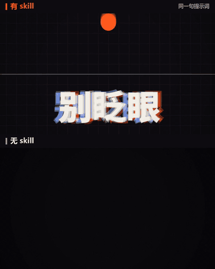

# motion-reel

一个 Claude Code skill：用一句话，做出**逐帧由代码绘制**的动态图形视频。产品广告、品牌宣传、展示卷、抖音/视频号竖屏广告都能做，自带按节拍合成的原创配乐，同一条时间轴同时导出 9:16、1:1 和 16:9。

A Claude Code skill that turns one sentence into a motion-graphics video rendered entirely from code, with an original beat-synced soundtrack, exported as MP4 in 9:16, 1:1 and 16:9 from a single timeline.



上：有 skill　下：无 skill　（同一句提示词）· [完整对比视频](https://github.com/10291124jcjc-dotcom/motion-reel/releases/latest)

## 同一句话，有没有这个 skill

提示词：「做一段 15 秒动态图形视频，展示你是多么出色的动态设计师，像简历的展示卷。全力以赴。」

| | 无 skill | 有 skill |
|---|---|---|
| 用时 | 13 分钟 | 9 分钟 |
| 镜头数 | 7 段 | 15 个 |
| 画面变化（中位数） | 5.96 | 8.98 |
| 静止画面占比 | 9% | 0% |
| 响度 | -10.9 LUFS（接近爆音） | -14 LUFS（平台标准） |

"有 skill"那条，是由一个没有任何对话背景的新会话只凭这个 skill 做出来的。测量用的是 skill 自带的 `check.py motion` 和 `check.py loud`。

## 它做了什么

提示词只占一小部分，真正起作用的是背后的流程：

- **确定性渲染引擎**：`render(t)` 是时间的纯函数，无头 Chrome 逐帧截图，ffmpeg 编码。同一输入永远得到同一帧，改一处只需重新渲染。
- **特效库**：弹簧物理、六种文字动效（拖影 / 旋转 / 弹跳 / 描边填充 / 故障 / 升起）、形状变形、冲击波、放射光芒、速度线、变速隧道、3D 文字环、生成式流场、条纹 / 撕裂 / 切片 / 推镜等转场。
- **代码合成配乐**：鼓组、贝斯、和弦、音效都用 numpy 合成，每一次砸字、转场都卡在节拍上；成片自动标准化到 -14 LUFS。
- **自查循环**：渲染关键帧拼成总览图，按 8 项（抓人、可读、动作、变化、构图、品牌、音画同步、能量）打分，每项 8 分以上才出片；另有剪辑点、手机尺寸、能量、响度检测。
- **"炫酷"规则**：默认高能量——画面永远在动、每个镜头三层、冲击叠加、按节拍快切，并用数据衡量。
- **分镜模板与合规要点**：展示卷、产品广告、促销、门店开业等结构；中国大陆广告法常见要求（绝对化用语、培训广告不得承诺结果、促销期限等）。

## 安装

```bash
# macOS / Linux
git clone https://github.com/10291124jcjc-dotcom/motion-reel ~/.claude/skills/motion-reel
```

```powershell
# Windows (PowerShell)
git clone https://github.com/10291124jcjc-dotcom/motion-reel "$env:USERPROFILE\.claude\skills\motion-reel"
```

依赖 / Requirements:

- Python 3.10+：`pip install playwright numpy scipy pillow`
- [ffmpeg](https://ffmpeg.org/) 在 PATH 里
- 已安装 Chrome 或 Edge（没有的话：`python -m playwright install chromium`）
- 中文字体推荐 [Noto Sans SC](https://fonts.google.com/noto/specimen/Noto+Sans+SC)（可免费商用）

目前只在 Windows 11 上完整测试过；macOS / Linux 理论上可用（没有 Bahnschrift 时会自动换用其他无衬线字体），欢迎反馈。

## 使用

在 Claude Code 里直接说需求即可，或输入 `/motion-reel`：

- 「帮我给我们的咖啡店做一条 20 秒的抖音开业广告，第二杯半价」
- 「把这份 PPT 做成 30 秒的招生宣传视频」
- 「做一段 15 秒动态图形视频，展示你是多么出色的动态设计师，像简历的展示卷。全力以赴。」

Claude 会按流程搜集事实、写分镜、建项目（`scripts/new_project.py`）、写场景、自查、配乐、渲染并交付 MP4。项目里的常用命令：

```bash
python audio.py                              # 合成配乐
python tools/render.py --every 0.5 --trans   # 关键帧 + 转场截图，用于自查
python tools/render.py --fmt all             # 渲染 9:16 / 1:1 / 16:9
python tools/finish.py --name 片名            # -14 LUFS、颗粒、编码成片
python tools/check.py motion out/片名_9x16.mp4  # 能量检测
```

## 目录

```
SKILL.md                 工作流程（Claude 读的主文件）
scripts/                 render.py · audio_lib.py · finish.py · check.py · new_project.py
assets/engine.html       动画引擎 + 特效库模板
assets/CLAUDE.md         每个新项目的工作室规则
assets/audio_template.py 配乐模板
assets/examples/         两个完整范例：展示卷、咖啡店开业广告（虚构品牌）
references/              energy.md 炫酷规则 · critique.md 自查 · storyboards.md 分镜 · compliance-cn.md 合规
```

## 致谢

方法论受 [@0xMovez](https://x.com/0xMovez) 的文章 *How to build motion design studio with Opus 5.5* 启发：提示词只占 10%，另外 90% 是背后的流程。本仓库代码为独立编写。

## License

[MIT](LICENSE)
